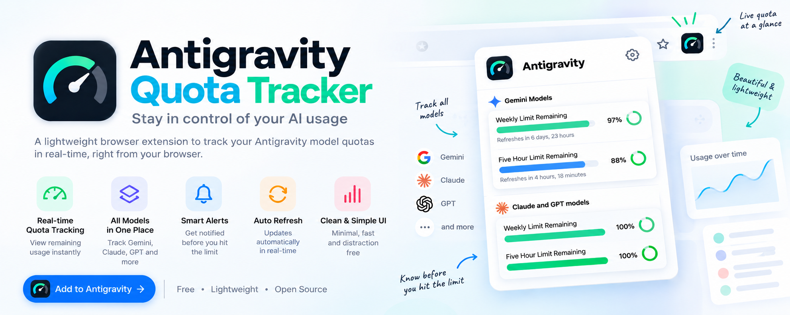
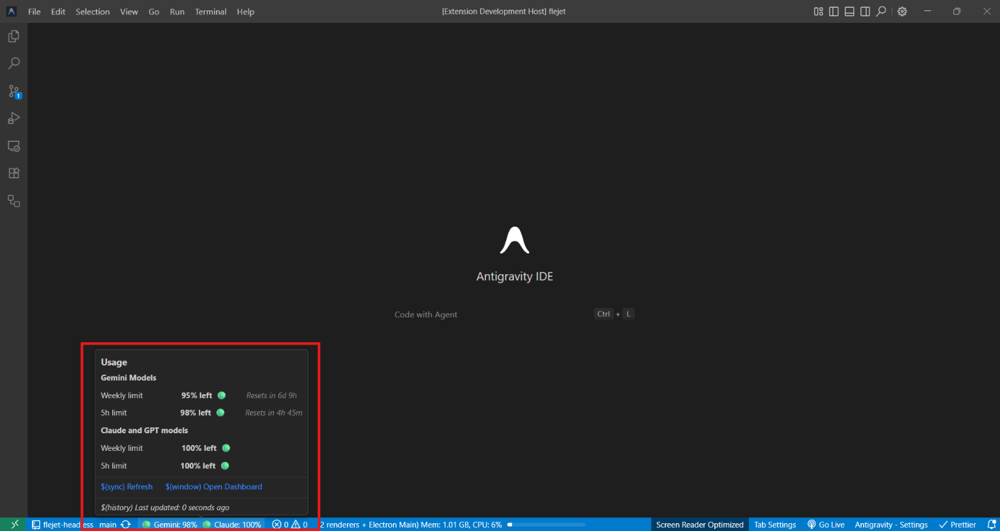

# Antigravity Model Quota Monitor

<p align="center">
  
</p>

<p align="center">
  <a href="https://github.com/SimpleCyber/vscode-antigravity-model-quota"></a>
  <a href="https://github.com/SimpleCyber/vscode-antigravity-model-quota/issues"></a>
  <a href="https://github.com/SimpleCyber/vscode-antigravity-model-quota/blob/main/LICENSE"></a>
  <a href="https://flejet.in"></a>
</p>

**Antigravity Model Quota Monitor** is a lightweight VS Code / Antigravity IDE extension that tracks your Google Antigravity AI model quotas (Gemini, Claude, GPT) in real-time right in your status bar and interactive dashboard.

---

## ✨ Features

### 1. Minimal & Informative Status Bar
Keep track of remaining quotas without clutter. The status bar displays real-time quotas for both **Gemini** and **Claude** pools, followed by branding and quick links.

```text
🟢 Gemini: 97%  🟢 Claude: 100%   🐰
```

Configurable via `agStatusBar.displayFormat`:
- **Standard**: `🟢 Gemini: 97%  🟢 Claude: 100%   🐰`
- **Compact**: `🟢97% | 🟢100%   🐰`
- **Minimal**: `🟢 🟢   🐰`


---

### 2. Rich Hover Tooltip
Hover over the status bar item to view the exact usage breakdown for your quota pools:
<p align="center">
  
</p>

- **Gemini Models**: Weekly limit & 5-hour limit percentages, along with exact time to reset (`Resets in 6d 23h`, `Resets in 4h 25m`).
- **Claude & GPT Models**: Independent tracking for Anthropic Claude and OpenAI GPT quotas.
- **Top-Right Quick Refresh**: Instant resync via the `🔄️` emoji in the top right corner.
- **Brand & Community Links**: Direct access to [flejet.in](https://flejet.in) and GitHub [Contribute here](https://github.com/SimpleCyber/antigravity-model-quota).


---

### 3. Antigravity 2.0 & Windsurf Integration
- Automatic process detection for both **Antigravity 2.0** (`agy.exe`) and legacy language server architectures.
- Intelligent discovery of hub ports and CSRF authentication tokens from command-line arguments and local process environments.
- Smart activity-based polling: refreshes seamlessly when code generation finishes, avoiding redundant API calls.

---

## ⚙️ Configuration

Fine-tune the monitor in VS Code Settings (`Ctrl+,` or `Cmd+,`):

| Setting | Default | Description |
|---|---|---|
| `agStatusBar.refreshInterval` | `15` | Interval in seconds to automatically poll quota data (Range: 5–3600) |
| `agStatusBar.displayFormat` | `standard` | Status bar format: `standard`, `compact`, or `minimal` |
| `agStatusBar.warningThreshold` | `60` | Percentage at which status indicators turn **yellow** |
| `agStatusBar.criticalThreshold` | `40` | Percentage at which status indicators turn **red** |
| `agStatusBar.isPremiumUser` | `false` | Enable display of extra premium tier models |

---

## ⌨️ Commands

Access these from the VS Code Command Palette (`Ctrl+Shift+P` / `Cmd+Shift+P`):

- **`Antigravity: Show Model Quota Details`**: Open the QuickPick model inspector.
- **`Antigravity: Open Model Quota Dashboard`**: Open the full webview dashboard with progress rings.
- **`Antigravity: Refresh Quota Data`**: Trigger an immediate quota resync.
- **`Antigravity: Visit Flejet.in`**: Open Flejet in your browser.
- **`Antigravity: View GitHub Repository`**: Visit this repository on GitHub.

---

## 🛠️ Building & Developing

```bash
# Clone repository
git clone https://github.com/SimpleCyber/antigravity-model-quota.git
cd antigravity-model-quota

# Install dependencies
npm install

# Build extension
npm run build

# Package VSIX
npm run package
```

Requirements: Node.js 18+ and npm.

---

## 🤝 Community & Credits

<p align="center">
  <a href="https://flejet.in">
    
  </a>
  &nbsp;&nbsp;&nbsp;&nbsp;&nbsp;&nbsp;
  <a href="https://github.com/SimpleCyber/antigravity-model-quota">
    
  </a>
</p>

- **Flejet**: Growth and social media workflow automation: [flejet.in](https://flejet.in)
- **GitHub**: [SimpleCyber/antigravity-model-quota](https://github.com/SimpleCyber/antigravity-model-quota)
- **Author**: SimpleCyber

---

## 📄 License

[MIT](LICENSE.txt)
